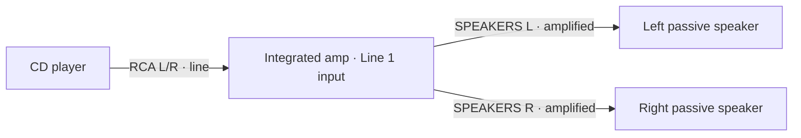
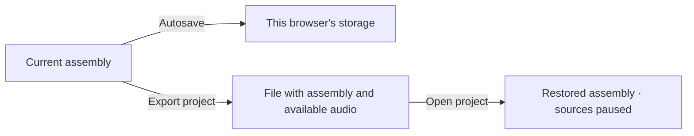

# Audio Lab

<picture>
  <source media="(prefers-color-scheme: dark)" srcset="assets/brand/audio-lab-logo-inverse.svg">
  
</picture>

Build a virtual audio system, connect its components, and listen in your browser. Explore sources, amplifiers, equalizers, speakers, and headphones in vintage, studio, and modern styles.


The symbol and light and dark wordmarks are editable SVGs in [`assets/brand`](assets/brand/README.md).

**[Complete wiki and guides](https://github.com/gperegr/AudioSystem/wiki)** · **[Setup examples](https://github.com/gperegr/AudioSystem/wiki/Exemplos-de-montagem)** · **[Troubleshooting](https://github.com/gperegr/AudioSystem/wiki/Problemas-frequentes)**

## Open Audio Lab and listen

1. Download the repository with **Code → Download ZIP**, then extract the complete archive.
2. Open **index.html** in an up-to-date browser such as Chrome or Edge. Keep the extracted folders together.
3. Keep an internet connection available for the interface styles and externally hosted interface fonts.
4. Click or tap the app to enable audio. Start with your computer's volume turned down.

An optional first-run guide recommends headphones and offers listening examples for loudness, subtle detail, left/right channels, bass, treble, and interface sounds. The loudness, detail, bass, and treble examples repeat briefly after you press **Play**; you can continue without choosing an answer. In **Subtle detail**, each answer plays one preview when repetition is stopped. Loudness and detail answers adjust the app volume. The bass and treble sliders adjust listening output from −6 to +6 dB; the **Interaction sounds** slider plays a preview as you move it. Return to a previous step, skip, repeat the guide in **Settings → Calibrate headphone volume**, or edit the levels in **Settings → Listening levels**. The browser does not measure the actual headphone volume. Start with your device volume low and keep listening at a comfortable level.

If you have the published app URL, open it directly. You do not need Node.js to use Audio Lab.

## Build your first system

Add a **CD Player**, an **Integrated · Blue Meters**, and two **Vintage Passive Speakers**. Drag items from the catalog, or tap an item name to add it on touch screens.



1. Connect the CD player's RCA OUT L/R to the integrated amp's **Line 1 L/R** input.
2. Connect one speaker to **SPEAKERS L** and the other to **SPEAKERS R**.
3. Turn on the equipment, select **Line 1**, and start playback on the CD player.
4. Raise the integrated amp's volume gradually.

Music sources provide a demo when no personal audio is loaded. To play a local file, select a source and choose **My music → LOAD AUDIO**. MP3 and WAV are common options; support depends on the browser. The Integrated Streamer also reads available MP3/FLAC metadata and cover art.

USB audio interfaces can select a computer input, adjust its level, and route the unprocessed signal to connected line and headphone outputs. Some share their output control; others adjust line and headphones separately. Select an interface, choose **Start capture**, and grant browser permission. Capture requires HTTPS or localhost and does not resume automatically when a project is opened.

## Inputs, outputs, and levels

| Signal | Source | Destination |
| --- | --- | --- |
| Line / LINE | CD player, streamer, preamp, or processor | Amplifier, processor, or active-speaker LINE input |
| PHONO | Turntable set to PHONO | PHONO input or PHONO-to-LINE converter |
| PHONES | Amplifier or headphone output | Compatible headphones |
| Amplified / SPEAKERS | Power amp, integrated amp, or receiver | Passive speaker or subwoofer |
| SUB / LFE | Line-level bass output | Active subwoofer |

Keep **L and R** matched. Stereo 3.5 mm/6.35 mm plugs may carry both channels, but some inputs are mono, such as the 6.35 mm input on the **Precision Active Speaker**. Check the labels: plug shape alone does not determine the signal. Passive adapters change connector or channel routing; converters change signal level or processing.

Warnings explain incompatible levels, loads, and simulated damage. Turning off connection guidance in Settings does not allow mismatched plug shapes to connect. See [Signals and connections](https://github.com/gperegr/AudioSystem/wiki/Sinais-e-conexoes).

## Navigation and controls

| Task | How it works |
| --- | --- |
| Adjust a device | Select one item to open its floating properties panel, confined to the canvas. Deselect it to close the panel. |
| Browse the catalog | The left catalog stays visible; on phones it becomes a single column. |
| Find equipment | Search by name, function, connector, or signal. |
| Adjust knobs and faders | Drag them. Supported controls also work with the keyboard and show their value while changing. |
| Select several devices | Use **Shift + click/drag**. **Ctrl/Cmd + A** selects all when the assembly has focus. Multi-selection keeps the properties panel closed. |
| Navigate the assembly | Use zoom and **Fit selection** (**C**): frames selected devices, or all devices when none are selected. |
| Undo/redo movement | Use the toolbar arrows or **Ctrl/Cmd + Z** / **Ctrl/Cmd + Shift + Z**. This history tracks positions. |
| Organize cables | Select a cable to set its label, color, visibility, and slack. Hiding a cable does not break the connection. |

Adjustment controls use discrete steps; input selectors and tuning have their own scales. **Restore Settings** appears on devices with restorable adjustments. Power amplifiers start at gain **5/10**; projects with saved gains preserve those values. This control position does not mean half of the rated wattage.

### Scene, floor, and lighting

In **Settings → Appearance → Background**, choose **Room** to show **Studio**, **Listening Room**, or **Industrial Loft**. These illustrated scenes were created from the earlier compositions with shapes and textures closer to the equipment artwork. Earlier background images remain in `assets/rooms` but are not offered in the menu. **Time of day** offers **Dawn**, **Late afternoon**, and **Night**. Time changes equipment lighting while leaving the background image free of filters and dynamic light beams. Each scene has its own floor. Other backgrounds (**Light**, **Graphite**, **Midnight Blue**, and **Sepia**) remain available.

First-run defaults are **Room → Industrial Loft**, **Late afternoon**, **Dots** grid, connection guidance on, developer mode off, **Small Room** with intensity **5**, app volume at **100%**, and interaction sounds at **50%**. Background, scene, time, grid, and zoom are remembered in the browser and stored with a project. Older projects using previous scenes open with their corresponding illustrated options.

The illustrated WebP scenes are intentionally soft and contain no fixed furniture or lamps. `assets/rooms/scenes.js` maps each image, floor, and invisible virtual light sources aligned with the windows. They illuminate equipment and furniture; particles continue to float in front of devices. The optional Audio Desk lamp, pendant light, and user-added wall lights also emit light and contribute to dynamic device shadows. The background is no longer overlaid with canvas glow, CSS beams, or lighting filters. Knobs, keys, sliders, and plugs retain contact shadows and distinct heights; shelves and furniture sides cast shadows inside their openings. Furniture and equipment cast soft shadows on the floor. The view stays frontal, and sound, connections, and control operation do not depend on visual effects.

The art direction combines modern mid-century interiors with softened photographic materials: restrained wood grain, concrete, brick, and acoustic fabric. Background contrast stays lower than the equipment and its controls.

When the canvas moves or zooms, the scene image moves at a different rate from the equipment to create parallax. Moving the pointer alone does not change the effect. Wide screens support zooming out to 50% without resizing furniture or equipment. Devices can extend slightly onto the pictured floor so they appear to rest on it.

The catalog separates **Furniture** from **Lighting**. The **Pendant light** follows ceiling height with an adjustable cable and gently swings; **Industrial** and **Dish** wall lamps can be moved along the walls. All lights illuminate equipment, and their shades block light outside their openings. The **DEBUG** category is hidden by default; enable **Settings → Developer mode** to show **Controls · Demo**. A small square icon on compatible speakers restores a removed grille.

### Spotify album collection

Under **Furniture**, add **Record Collection · Spotify**, available in light or dark wood. Drag, scroll, or use the arrows over the covers to browse saved albums. Select a cover to open the record; select it again or use the play control to start playback. The lower bar jumps to a position and sorts the collection. Only covers near the current position are rendered.

To connect, register the **Redirect URI** shown in **Settings → Spotify** at [Spotify for Developers](https://developer.spotify.com/dashboard). The project provides a prefilled Client ID that you can change in that section. Open Audio Lab over HTTPS or at `http://127.0.0.1` through a local server: PKCE authorization and the Web Playback SDK do not work when opening `index.html` directly from disk. Spotify Premium is required for browser playback. The Spotify player is shared across furniture items; its audio does not pass through the simulated cables or signal system.

Each item saves its position, sort order, and selected album. The Client ID remains in the browser; access tokens stay in the session. The library and tokens are not exported with a project. Reconnect your account after opening the project in another browser.

### Phones and tablets

The **Equipment** and **Properties** icons open drawers over the assembly. Close a drawer with its fixed button or by tapping outside. On narrow screens, swipe the top toolbar horizontally. Use two fingers to move or zoom the canvas; press and hold before moving a device, or enable **Touch Mode** for immediate dragging.


### Noise, sound signature, and comparison

On turntables, the four **Vinyl noise** icons choose none, low, medium, or high. On the tape deck, **Tape noise** uses the same four levels; the three **Tape wow** waves choose low, medium, or high. The active choice is highlighted, and names are available in tooltips and accessible navigation.


On headphones and speakers with a **Sound signature** panel, indicators summarize the same curve shown in the graph: bass at **60–200 Hz**, mids at **300–2,500 Hz**, and treble at **5,000–12,000 Hz**. The center is neutral from **−1 to +1 dB**; strong cut/boost begins at a **4 dB** deviation. A local peak can differ from the average across a band. Global volume reduction for headroom does not move the indicators.


On amplifiers, **Sonic behavior** uses a different scale to compare the model's bass, treble, saturation, and even harmonics. To compare outputs, keep levels similar and use **SOLO** and **MUTE** in the listening panel. Sound signature describes a model's tonal profile; a spectrum shows signal content at a particular point in the chain.

## Guides by topic

| Wiki guide | Topics |
| --- | --- |
| [Audio sources](https://github.com/gperegr/AudioSystem/wiki/Fontes-de-audio) | Turntables, tape, CD, streamers, radio, and virtual Bluetooth |
| [Amplification](https://github.com/gperegr/AudioSystem/wiki/Amplificacao) | Preamps, integrated amps, receivers, power amps, and headphone outputs |
| [Speakers, subwoofers, and headphones](https://github.com/gperegr/AudioSystem/wiki/Caixas-subwoofers-e-fones) | Active/passive models, grilles, headphones, and impedance |
| [Sound signature](https://github.com/gperegr/AudioSystem/wiki/Assinatura-sonora) | 0 dB reference, indicators, frequency bands, and visual examples |
| [Processors](https://github.com/gperegr/AudioSystem/wiki/Processadores-de-audio) | Seven-band EQ, mixers, and crossovers |
| [Selectors and adapters](https://github.com/gperegr/AudioSystem/wiki/Seletores-e-adaptadores) | A/B paths, routing matrices, and level conversion |
| [Generators and meters](https://github.com/gperegr/AudioSystem/wiki/Geradores-e-medidores) | Sine, sweep, pink noise, and signal measurement |
| [Settings and projects](https://github.com/gperegr/AudioSystem/wiki/Configuracoes-e-projetos) | Furniture, the audio desk, presentation, sound, saving, and export |

Bluetooth and FM radio are virtual; the app does not pair with physical devices or receive broadcasts through a computer antenna. Compare the same passage and change one component at a time.

## Save and share

When available, autosave uses local browser storage. Check the status in the interface; saved data belongs to the browser and address used to open the app.



**Export project** downloads a copy containing device positions, cables, settings, and available music files. **Open project** replaces the current assembly; export anything you want to keep first. Clearing browser data, changing browsers or addresses, or using private browsing may prevent local saves from being recovered. Export important projects.

## If there is no sound

1. Click or tap the app and start the source. Restored projects begin paused.
2. Check media volume, the selected device output, and whether the browser tab is muted.
3. Check power, volume/gain, the selected input, SOLO, and MUTE.
4. Follow the path from source to listening output; check L/R, signal type, and load warnings.
5. For personal music, try another compatible file such as MP3 or WAV.

On iPhone or iPad Safari, tap **Play**. When returning from another tab, an already activated session attempts to resume; tap again if needed. See [Troubleshooting](https://github.com/gperegr/AudioSystem/wiki/Problemas-frequentes).

## Development and references

The [architecture decision record](docs/adr/0001-application-architecture.md) describes the runtime, state, storage, configuration, and maintenance workflow.

The app uses HTML, CSS, and JavaScript. These checks require Node.js but no additional dependencies:

```sh
node tools/build-script.cjs --check
node --check script.js
node --test tests/*.test.cjs
```

Application code is split by responsibility in [`src/app/`](src/app/README.md); supporting modules are in [`src/modules/`](src/modules/README.md), translations in [`src/i18n/`](src/i18n/README.md), and styles in [`styles/`](styles/README.md). After editing a section under `src/app/`, regenerate `script.js` with `node tools/build-script.cjs`. The app and hosting continue to load this classic entry point from the repository root beside `index.html`.

Choose Portuguese or English in the **Language** selector at the root of Settings. [`languages.js`](src/i18n/languages.js) provides translations and tracks dynamic interface elements; the selected language is saved in this browser.

The test suite covers audio activation/resumption, moving groups with furniture, and consistent sound-signature indicators. See the [signal model and electrical limits](docs/reference/REVISAO-SINAIS.md), [control library](docs/reference/COMPONENTES.md), and [equipment fonts](assets/fonts/README.md).

The [documentation images](docs/images/README.md) are simulator captures; diagrams illustrate signal paths. Models are virtual approximations: W, Ω, dB, and graphs are not measurements of physical equipment or predictions of acoustic volume in a room. Consult manufacturers' specifications for real systems.

### Guided access and examples

**Settings → Guided access** opens an interactive tutorial in the current project. A lower bar guides one action at a time, highlights controls, and offers **Locate**, **Back**, **Skip topic**, and **Exit**. The next arrow becomes available when the app detects the completed action. No music, authentication, or capture starts automatically. Changes made while practicing remain in the project.

On first launch, the invitation appears after calibration is completed or skipped. You can decline, continue later, or restart from Settings. Progress is preserved when returning from Spotify authentication. The Spotify topic explains that equalizers and other effects do not process Spotify audio; the chain controls audibility and volume.

**Settings → Setup examples** is a separate feature with five systems on furniture: CD/MP3 with active speakers; external input with an amplifier and passive speakers; an equalization lab; tape with shared headphones; and a Spotify collection with a turntable. The menu lists each example's requirements and first step. Replacing a nonempty canvas requires confirmation. Export your project first if you may need it later. The app stores the current assembly locally before replacement and restores it with its audio files if loading fails. Replacement requires local storage and resets movement history. Sources start paused, with no active capture.


To validate guided access, run `node --test tests/guided-access.test.cjs`. The optional browser check uses Playwright and Chromium: start a local server, then run `node tests/guided-access.browser.cjs` (`TEST_BASE_URL` and `CHROMIUM_PATH` can change the address and executable).

Loose album covers and records snap to the grid when dropped on the canvas, including when restoring a project. A record on a turntable follows the platter's exact position. During startup, the interface appears after catalog preparation and project restoration; the HTML no longer contains the replaced catalog drawings.
