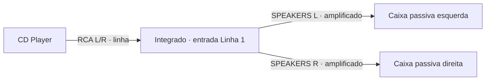
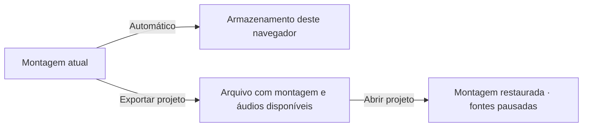

# Audio System Simulator

Monte um sistema de som virtual, conecte os equipamentos e ouça o resultado no navegador. Explore fontes, amplificadores, equalizadores, caixas e fones com estilos vintage, de estúdio e modernos.


**[Wiki e guias completos](https://github.com/gperegr/AudioSystem/wiki)** · **[Exemplos de montagem](https://github.com/gperegr/AudioSystem/wiki/Exemplos-de-montagem)** · **[Solução de problemas](https://github.com/gperegr/AudioSystem/wiki/Problemas-frequentes)**

## Abrir e ouvir

1. Baixe o repositório em **Code → Download ZIP** e extraia todo o conteúdo.
2. Abra **index.html** em Chrome, Edge ou outro navegador atualizado, mantendo as pastas juntas.
3. Mantenha internet disponível para os recursos externos de estilo e as fontes da interface.
4. Clique ou toque no programa para liberar o áudio. Comece com o volume do computador baixo.

Na primeira abertura, um guia opcional recomenda fones e oferece exemplos de som forte, detalhe sutil, canais esquerdo/direito, graves, agudos e sons da interface. Os exemplos de som forte, detalhe, graves e agudos se repetem com pausas curtas após tocar em **Tocar**; é possível avançar sem escolher uma resposta. Em **Detalhe sutil**, cada resposta toca uma prévia única quando a repetição está parada. As respostas sobre som forte e detalhe ajustam o **volume do programa**. Os sliders de graves e agudos ajustam a saída de escuta entre −6 e +6 dB; o slider de **sons de interação** toca uma prévia ao mover. Você pode voltar ou pular, repetir o guia em **Configurações → Calibrar volume dos fones** ou editar os níveis em **Configurações → Níveis de escuta**. O navegador não mede o volume real do fone; comece com o dispositivo baixo e mantenha um nível confortável.

Se você recebeu o endereço da aplicação publicada, abra-o diretamente. O programa não exige instalar Node.js para ser usado.

## Sua primeira montagem

Adicione um **CD Player**, um **Integrado · Visores Azuis** e duas **Caixas Passivas Vintage**. Arraste do catálogo; no toque, toque no nome para adicionar.



1. Ligue RCA OUT L/R do CD à entrada **Linha 1 L/R** do integrado.
2. Ligue uma caixa a **SPEAKERS L** e a outra a **SPEAKERS R**.
3. Confira a alimentação dos aparelhos, selecione **Linha 1** e inicie a reprodução no CD.
4. Ajuste o volume do integrado gradualmente.

As fontes musicais oferecem demonstração quando não há música própria. Para ouvir um arquivo local, selecione a fonte e use **Música própria → CARREGAR ÁUDIO**. MP3 e WAV são opções comuns; a compatibilidade depende do navegador. O Streamer Integrado também lê metadados e capa de MP3/FLAC quando disponíveis.

## Entradas, saídas e níveis

| Sinal | Origem | Destino |
| --- | --- | --- |
| Linha / LINE | CD, streamer, pré ou processador | LINE de amplificador, processador ou caixa ativa |
| PHONO | Toca-discos em PHONO | Entrada PHONO ou conversor PHONO → LINHA |
| PHONES | Amplificador ou saída de fones | Fones compatíveis |
| Amplificado / SPEAKERS | Potência, integrado ou receiver | Caixa ou subwoofer passivo |
| SUB / LFE | Saída de graves em nível de linha | Subwoofer ativo |

Preserve **L e R**. P2/P10 podem reunir estéreo, mas há entradas mono, como a P10 da **Caixa Ativa · Precisão**. Confira os rótulos: o formato do plugue sozinho não determina o sinal. Adaptadores passivos mudam conectores e canais; conversores alteram o nível ou a preparação do áudio.

Os avisos explicam níveis incorretos, carga e possíveis danos simulados. Desativar a ajuda em Configurações não permite encaixar plugues de formatos diferentes. Consulte [Sinais e conexões](https://github.com/gperegr/AudioSystem/wiki/Sinais-e-conexoes).

## Navegação e controles

| Ação | Como fazer |
| --- | --- |
| Ajustar um aparelho | Selecione-o; o painel direito mostra seu nome e os controles disponíveis. |
| Recolher o painel direito | Use a seta ao lado de **Configurações**, na barra superior. A largura é fixa entre equipamentos e o painel desliza ao abrir/fechar. |
| Recolher o catálogo | Use a seta no cabeçalho do catálogo; a alça permite reabri-lo. |
| Procurar equipamentos | Busque por nome, função, conector ou sinal. |
| Ajustar knobs e faders | Arraste; controles compatíveis aceitam teclado e mostram o valor durante o ajuste. |
| Selecionar vários | **Shift + clique/arraste**; **Ctrl/Cmd + A** seleciona todos quando o foco está na montagem. |
| Navegar na montagem | Use zoom, **Centralizar** e **Ajustar para exibir tudo**. |
| Desfazer/refazer movimento | Use as setas da barra ou **Ctrl/Cmd + Z** / **Ctrl/Cmd + Shift + Z**. Esse histórico é de posições. |
| Organizar cabos | Selecione um cabo para ajustar etiqueta, cor, visibilidade e folga. Ocultar não corta o áudio. |

Os controles de ajuste usam passos discretos; seletores e sintonia têm escalas próprias. **Restaurar Configurações** aparece nos aparelhos com ajustes restauráveis. Nas potências, o ganho padrão é **5/10**; projetos com ganhos próprios preservam seus valores. Isso não significa metade da potência nominal em watts.

### Cenário, piso e iluminação

Em **Configurações → Fundo**, escolha **Cenário** para mostrar **Estúdio**, **Sala de audição** ou **Loft industrial**. Essas opções usam as imagens ilustradas, criadas sobre a composição das imagens anteriores com formas e texturas mais próximas da arte dos equipamentos. As imagens anteriores permanecem em `assets/rooms`, mas não aparecem no menu. O menu **Hora do dia** oferece **Nascer do dia**, **Fim de tarde** e **Noite**; cada cenário ajusta a luz e o tom da mesma imagem conforme o horário e mantém seu próprio piso. Os outros fundos (Claro, Grafite, Azul noturno e Sépia) continuam disponíveis. Na primeira abertura, os padrões são **Cenário → Loft industrial**, **Fim de tarde**, grade de **Pontos**, orientação de conexões ativa, modo desenvolvedor desativado, **Sala pequena** com intensidade **5**, volume do programa em **100%** e sons de interação em **50%**. Fundo, cenário, hora do dia, grade e zoom são lembrados no navegador e acompanham o projeto salvo. Projetos antigos com cenários anteriores são abertos nas opções ilustradas correspondentes.

Os cenários são imagens WebP propositalmente desfocadas e sem móveis nem luminárias fixas. `assets/rooms/scenes.js` guarda apenas a escolha da imagem, o piso e as fontes virtuais invisíveis alinhadas às janelas. Elas iluminam equipamentos e móveis; partículas flutuantes aparecem nos fachos ao nascer do dia e no fim de tarde. Uma camada transparente à frente dos equipamentos desenha essas partículas com mais nitidez e inclui outras maiores, próximas do observador. A luminária opcional da Mesa de Áudio, a luminária pendente e as arandelas adicionadas pelo usuário também emitem luz e participam das sombras dinâmicas. Ao amanhecer, a luz das janelas predomina; à noite, as janelas escurecem e as luminárias adicionadas passam a definir a atmosfera. Knobs, teclas, sliders e plugues mantêm sombras de contato e alturas diferentes; prateleiras e laterais dos móveis criam sombras no seu interior. Móveis e equipamentos também projetam sombras suaves no piso. A vista permanece frontal; áudio, conexões e funcionamento dos controles não dependem dos efeitos visuais.

A direção visual combina interiores mid-century modernos com materiais fotográficos suavizados: madeira de veios discretos, concreto, tijolo e tecido acústico. O fundo tem menos contraste que os aparelhos e seus controles.

Ao deslocar ou ampliar o canvas, a imagem do cenário se move em velocidade diferente dos equipamentos, criando paralaxe. Mover somente o cursor não altera esse efeito. O enquadramento permite zoom-out de 50% em telas amplas, sem redimensionar móveis ou equipamentos. Os aparelhos podem avançar um pouco sobre o piso da imagem para parecerem apoiados nele.

A categoria **Móveis** inclui a **Luminária pendente**, que acompanha a altura do teto com o cabo e balança discretamente, e três arandelas de parede: **Industrial**, **de prato** e **de filamento**. Todas iluminam os equipamentos; as cúpulas bloqueiam a luz fora da sua abertura. As arandelas podem ser arrastadas livremente pelas paredes e são salvas com o projeto. A categoria **DEBUG** fica oculta por padrão; ative **Configurações → Modo desenvolvedor** para mostrar **Modelo · Controles** no catálogo. Projetos que já contêm esse modelo continuam funcionando. Em caixas com grade removível, um pequeno botão quadrado com ícone permite recolocá-la.

### Celulares e tablets

Os ícones **Equipamentos** e **Propriedades** abrem gavetas sobre a montagem. Feche pelo botão fixo ou tocando fora. Em telas estreitas, deslize a barra superior horizontalmente. Use dois dedos para mover/ampliar o canvas; pressione e segure antes de mover um aparelho, ou ative **Modo Touch** para arraste imediato.


### Ruído, assinatura sonora e comparação

Nos toca-discos, os quatro ícones de **Ruído do vinil** escolhem sem ruído, baixo, médio ou alto. No tape deck, **Ruído de fita** usa os mesmos quatro níveis; as três ondas em **Oscilação da fita** escolhem baixa, média ou alta. O botão ativo fica iluminado e os nomes aparecem nas dicas e na navegação acessível.


Nos fones e caixas com **Assinatura sonora**, os indicadores resumem a mesma curva do gráfico: graves em **60–200 Hz**, médios em **300–2.500 Hz** e agudos em **5.000–12.000 Hz**. O centro é neutro entre **−1 e +1 dB**; recuo/realce forte começa em **4 dB** de desvio. Um pico localizado pode diferir da média da faixa. A redução global de volume para reservar margem não desloca os indicadores.


Em amplificadores, **Comportamento sonoro** usa outra escala: compara o perfil base de graves, agudos, saturação e harmônicos pares. Para comparar saídas, mantenha níveis próximos e use **SOLO** e **MUTE** no painel de escuta. A assinatura é um perfil tonal do modelo; o espectro mostra o conteúdo do sinal naquele ponto.

## Guias por assunto

| Guia da wiki | Conteúdo |
| --- | --- |
| [Fontes de áudio](https://github.com/gperegr/AudioSystem/wiki/Fontes-de-audio) | Toca-discos articulados e tangencial, tape, CD, streamer, rádio e Bluetooth virtual |
| [Amplificação](https://github.com/gperegr/AudioSystem/wiki/Amplificacao) | Prés, integrados, receivers, potências e saídas de fones |
| [Caixas, subwoofers e fones](https://github.com/gperegr/AudioSystem/wiki/Caixas-subwoofers-e-fones) | Ativos/passivos, grades, modelos de fones e impedância |
| [Assinatura sonora](https://github.com/gperegr/AudioSystem/wiki/Assinatura-sonora) | Referência de 0 dB, indicadores, faixas e exemplos visuais |
| [Processadores](https://github.com/gperegr/AudioSystem/wiki/Processadores-de-audio) | EQ de sete bandas, mixers e crossovers |
| [Seletores e adaptadores](https://github.com/gperegr/AudioSystem/wiki/Seletores-e-adaptadores) | Caminhos A/B, matriz e conversão de níveis |
| [Geradores e medidores](https://github.com/gperegr/AudioSystem/wiki/Geradores-e-medidores) | Senoide, varredura, ruído rosa e medições do sinal |
| [Configurações e projetos](https://github.com/gperegr/AudioSystem/wiki/Configuracoes-e-projetos) | Móveis, bancada, apresentação, áudio, salvamento e exportação |

Bluetooth e rádio são virtuais; o programa não faz pareamento com aparelhos físicos nem recebe emissoras por uma antena do computador. Compare o mesmo trecho e um componente de cada vez.

## Salvar e compartilhar

O salvamento automático usa o armazenamento local, quando disponível. Confira o status na interface; os dados pertencem ao navegador e ao endereço usados.



**Exportar projeto** baixa uma cópia com posições, cabos, ajustes e músicas disponíveis. **Abrir projeto** substitui a montagem atual; exporte antes o que quiser preservar. Limpar dados, mudar de navegador/endereço ou usar navegação privada pode impedir recuperar o salvamento local. Exporte os projetos importantes.

## Se não houver som

1. Clique/toque na aplicação e inicie a fonte; projetos restaurados começam pausados.
2. Confira o volume de mídia, a saída do dispositivo e se a aba está silenciada.
3. Verifique alimentação, volume/ganho, entrada selecionada, SOLO e MUTE.
4. Siga a cadeia da fonte à escuta, conferindo L/R, tipo de sinal e avisos de carga.
5. Para música própria, teste outro arquivo compatível, como MP3 ou WAV.

No Safari de iPhone/iPad, toque em Reproduzir. Ao voltar de outra aba, a sessão já ativada tenta retomar; se necessário, toque novamente. Veja [Problemas frequentes](https://github.com/gperegr/AudioSystem/wiki/Problemas-frequentes).

## Desenvolvimento e referências

A aplicação é composta de HTML, CSS e JavaScript; os testes abaixo exigem Node.js, sem dependências adicionais:

```sh
node --check script.js
node --test tests/*.test.cjs
```

A suíte cobre ativação/retomada do áudio, movimento de grupos em móveis e coerência dos indicadores de assinatura sonora. Consulte [modelo de sinais e limites elétricos](REVISAO-SINAIS.md), [biblioteca de controles](COMPONENTES.md) e [fontes dos equipamentos](assets/fonts/README.md).

As [imagens da documentação](docs/images/README.md) são capturas do simulador; os diagramas mostram percursos de sinal. Os modelos são aproximações virtuais: W, Ω, dB e os gráficos não são medições de equipamentos físicos nem previsão do volume acústico na sala. Para um sistema real, consulte as especificações dos fabricantes.
