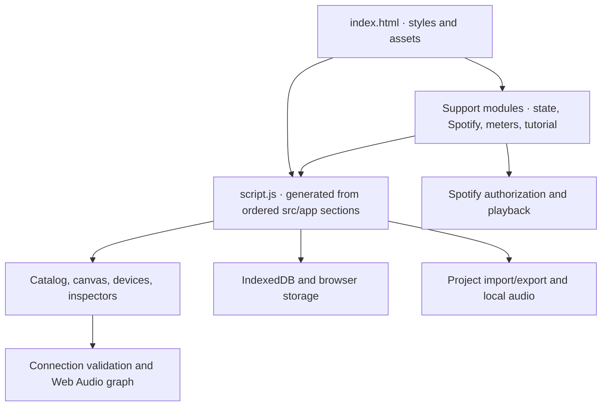

# ADR 0001: Audio Lab application architecture

- **Status:** Accepted (documents the existing implementation)
- **Date:** 2026-10-28
- **Scope:** Browser runtime, source organization, state, audio, persistence, and development workflow

## Context

Audio Lab is a client-side virtual audio system. It lets users place equipment, connect compatible ports, play and process audio, and save assemblies. The application must run as a static site without an application server while preserving the existing device implementations, shared browser globals, and saved projects. This record describes the current architecture; it is not a proposal to rewrite it.

## Decision

Use a static HTML/CSS/JavaScript application with a generated classic-script entry point. Keep related code in ordered source sections, expose focused browser support modules as classic scripts, and model equipment and its audio connections in the browser. Persist projects and preferences locally, with explicit project export for portability.

### Startup and source organization

- `index.html` loads room data, the support modules and `src/i18n/languages.js` before `script.js`. The order in the HTML is significant.
- `tools/build-script.cjs` concatenates the 23 ordered files in `src/app/` into the committed root `script.js`. These sections share a classic-script lexical scope and declaration hoisting; they are not independent ES modules. The section list in the build script is authoritative.
- `src/app/00-hardware-library.js` defines shared hardware controls; subsequent sections cover state, canvas, catalog, audio routing, sources, device creation and disposal, inspectors, cables, connection validation, Spotify objects, persistence, settings, and startup.
- `src/modules/` contains focused classic scripts, including application state, audio interfaces, Spotify coverflow, signal history, equipment acoustics, adapter rendering, and guided access. See [the modules guide](../../src/modules/README.md).
- `styles/app.css` and `styles/equipment/` style the application and equipment; `styles/interface-palettes.css` supplies interface palette tokens. Room images and mapping are under `assets/rooms/`. See the [interface design system](../UI-DESIGN-SYSTEM.md).

### State and runtime lifecycle

`appState` groups state into `project`, `canvas`, `audio`, `preferences`, and `interface` domains. Use named `appStateStore.actions` for domain mutations with side effects; existing compatibility accessors support incremental migration. Device-specific state and setters remain with each device. Spotify authorization and playback state belong to `SpotifyCoverflow`.

Removing a device must go through `disposeDeviceRuntime` in `src/app/12-device-interactions.js`: it invalidates pending capture requests and disposes media tracks, audio, animation, and controller resources. Signal-history taps are temporary, read-only, and released when the panel closes, the document is hidden, or the device is removed. Do not persist live audio nodes, transient meter samples, or active capture sessions.

### Audio and connections

Devices expose ports and use a Web Audio graph for simulated audio. Connection validation checks port direction, physical connector compatibility, signal level, feedback loops, and load implications before installation; adapters and converters have distinct behaviors. Signal history measures the connected component without changing the signal path. Simulated electrical ratings and tonal profiles are educational approximations, not physical measurements. See [audio signals and the electrical model](../reference/REVISAO-SINAIS.md).

Spotify playback is handled by the Spotify Web Playback SDK and does not pass through the simulated DSP chain or signal-history meters. Browser audio needs a user gesture; microphone capture requires HTTPS or localhost and permission. Spotify authorization requires its configured redirect URI and HTTPS or localhost. Restored sources start paused, and capture is not automatically resumed.

### Persistence and configuration

| Location or variable | Purpose |
| --- | --- |
| IndexedDB `audio-system-local-project` | Primary local project persistence, including available audio data. |
| `localStorage` `audio-system-project-fallback` | Project snapshot fallback; audio persistence is not guaranteed by the fallback. |
| `localStorage` `audio-system-interface-preferences` | Canvas, appearance, listening, and other interface preferences. |
| `localStorage` `audio-system-language` | Selected UI language (`pt` or `en`). |
| `audio-system-tutorial-v2` | Guided-access progress storage key. |
| `sessionStorage` `audio-system-spotify-session`, `audio-system-spotify-verifier`, `audio-system-spotify-state` | Spotify session and PKCE authorization data; not exported with projects. |
| `TAILWIND_SCRIPT_FILE` | Optional local Tailwind script used by supported browser checks. |
| `TEST_BASE_URL`, `CHROMIUM_PATH` | Optional server address and Chromium executable for supported browser checks. |
| `SIGNAL_HISTORY_SCREENSHOT` | Optional output path for the signal-history browser preview. |

Storage is scoped to the browser and origin and can be unavailable or cleared. Export projects to retain a portable copy; opening a project replaces the current assembly. The app is static and has no required server-side environment variables. The HTML loads Tailwind and general interface fonts externally; equipment fonts are included locally. Spotify settings include a configurable client ID and redirect URI; do not put access tokens into source files or documentation.

### Development and verification

1. Edit the relevant numbered section in `src/app/`, not generated `script.js`. For support modules or styles, edit their source files directly.
2. If an application section changed, regenerate with `node tools/build-script.cjs`; commit the generated file with its source. Preserve ordering unless shared-scope dependencies have been reviewed.
3. Run `node tools/build-script.cjs --check`, `node --check script.js`, and relevant tests. `node --test tests/*.test.cjs` runs the Node suite; browser checks and their prerequisites are described in [tests/README.md](../../tests/README.md).
4. For development, serve the repository root, for example with `python3 -m http.server 8765 --bind 127.0.0.1`, and open `http://127.0.0.1:8765/`. Basic use can also open `index.html` directly, but capture and Spotify require a suitable origin.
5. When changing persistence, validate old project loading, failed-save behavior, and cleanup. When changing signal routing, validate compatible and incompatible connections and device disposal. Update this ADR when the architectural decision changes.

## Consequences and tradeoffs

- Static hosting and a small build step make distribution straightforward. Users retain control of local projects and audio files.
- Ordered classic scripts preserve existing behavior, but shared globals and initialization order make dependencies less explicit. A source edit requires regenerating and committing `script.js`.
- Browser storage is origin-specific and subject to browser limits; export is important for recovery and migration.
- External fonts, Tailwind, Spotify services, browser permissions, and autoplay policies can affect particular features. Spotify playback is separate from the simulated signal graph.
- The simulation prioritizes interactive understanding over certification of physical equipment. Detailed model assumptions live in the linked reference.

## Alternatives considered

- **Load every application section separately or convert immediately to ES modules:** clearer boundaries, but changes shared scope, ordering, and initialization assumptions across the existing code. The current concatenation preserves those contracts while allowing source files to be maintained separately.
- **Require a server and centralized project database:** would simplify cross-device synchronization, but adds hosting, authentication, and operational dependencies to a static, locally usable application. Explicit export addresses portability in the current design.
